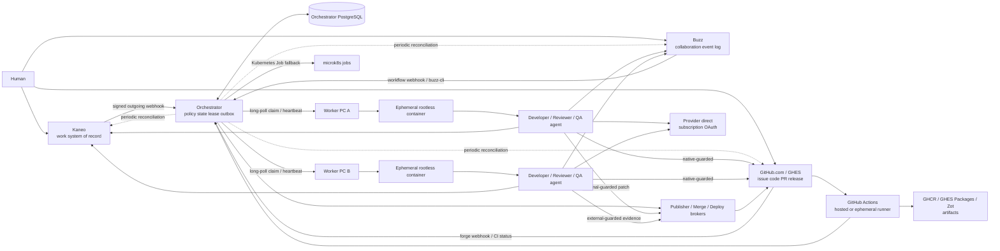
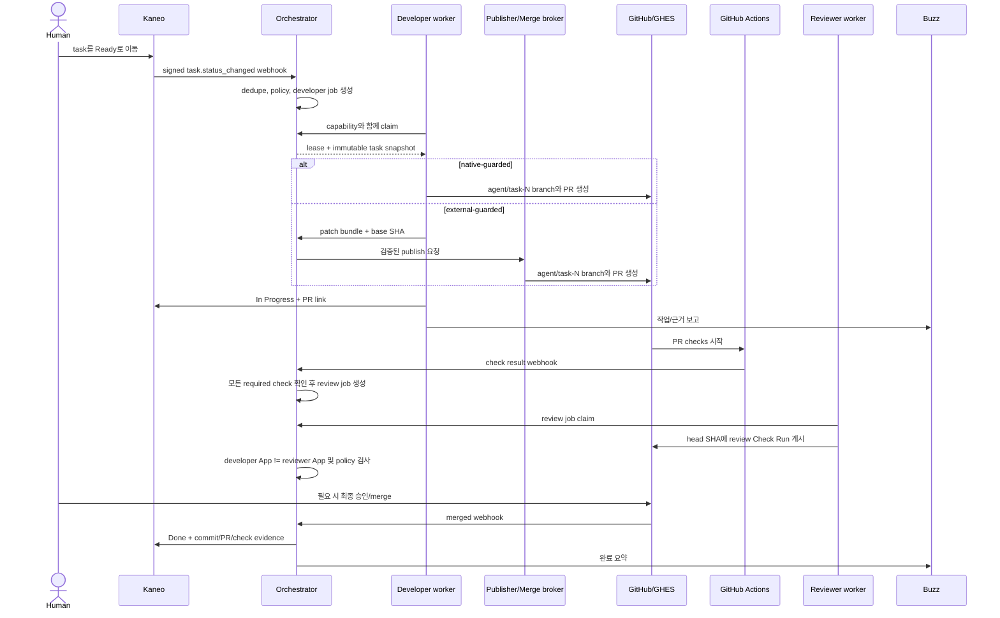
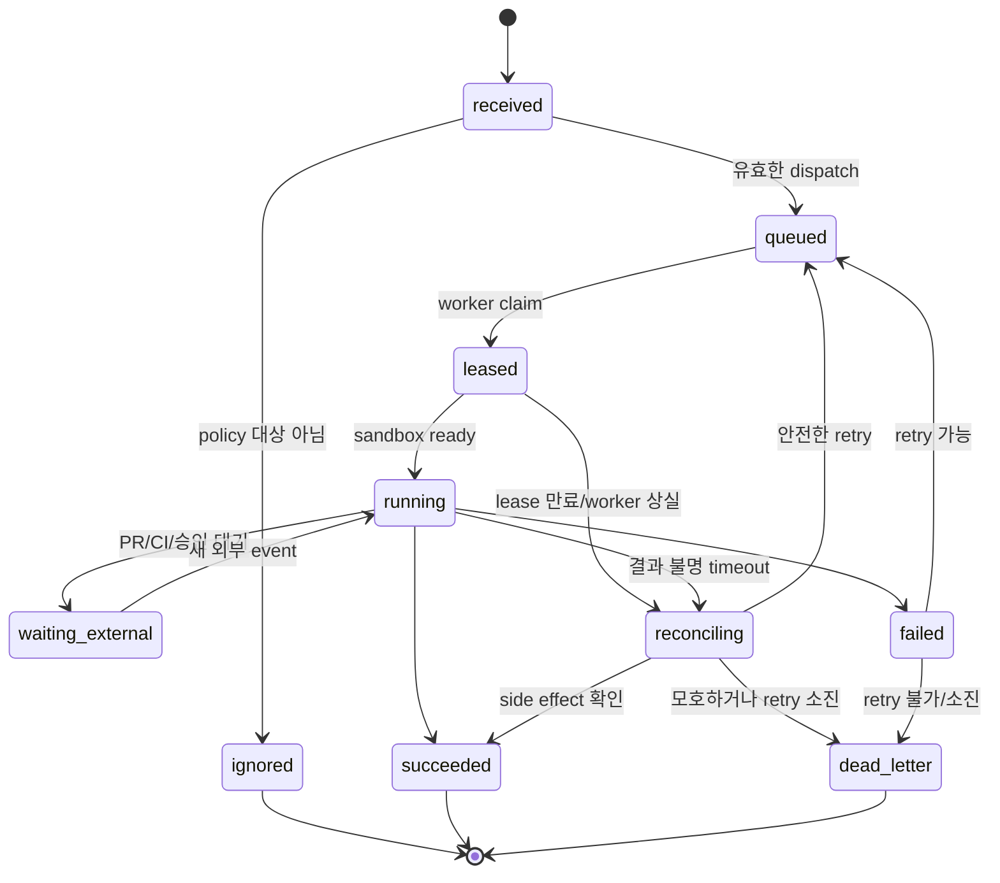

# 권장 아키텍처

## 1. 설계 원칙

1. **원장을 분리한다.** 작업은 Kaneo, 대화는 Buzz, issue/코드/PR은 GitHub/GHES,
   검증은 GitHub Actions가 최종 권위다.
2. **에이전트와 실행기를 분리한다.** persona는 행동 계약이고 worker는 격리와 수명
   주기를 책임진다.
3. **push가 아니라 pull한다.** 각 PC는 외부에서 SSH 명령을 받지 않고 outbound HTTPS로
   job을 claim한다.
4. **재전송과 유실을 모두 전제로 한다.** 내부 job은 at-least-once로 실행하고 모든
   event와 side effect는 idempotency key를 가진다. 외부 원장은 주기적으로 재조회한다.
5. **사람의 승인을 코드로 강제한다.** prompt에만 “승인을 받아라”라고 적지 않는다.
6. **한 credential은 한 책임만 가진다.** 개발, 리뷰, CI, 릴리스 identity를 분리한다.
7. **자연어는 비신뢰 입력이다.** issue, comment, diff, test log는 prompt injection을
   포함할 수 있다.

## 2. 논리 구성



## 3. 책임 경계

| 컴포넌트 | 책임 | 책임이 아닌 것 |
|---|---|---|
| Kaneo | task, 수락 조건, priority, assignee, workflow column | 코드 상태, CI 성공의 진실 |
| Buzz | 호출, 토론, 결과 보고, signed agent identity, human-visible audit | durable job queue, release authorization 단독 판정 |
| GitHub/GHES | issue, branch, commit, PR, review, ruleset, tag, deployment | Kaneo 업무 상태의 원장 |
| GitHub Actions | 재현 가능한 build/test/security check와 environment gate | 제품 요구사항 판정 |
| Orchestrator | event ingest, policy, dedupe, lease, retry, reconciliation | 코드 작성이나 LLM 추론 |
| Worker | host 등록, capability 광고, sandbox 생성/삭제, heartbeat | 업무 우선순위 결정 |
| Agent runtime | 역할별 계획/개발/리뷰/테스트 해석 | credential 발급, 자기 권한 확대, 최종 release 승인 |

## 4. Agent 모델

### 4.1 세 개의 서로 다른 개념

```text
AgentDefinition (논리 역할)
  ├─ persona prompt / skills / tool policy
  ├─ 허용 model class / subscription usage policy
  └─ 요구 capability와 금지 권한

AgentInstance (실제 행위자)
  ├─ 고유 instance_id
  ├─ 고유 Buzz Nostr key
  ├─ 고유 Kaneo user + API key
  ├─ execution-scoped GitHub App installation token
  └─ host subscription credential profile reference

Execution (한 번의 작업)
  ├─ job_id / attempt / lease token
  ├─ task_id / repo / base SHA
  ├─ 임시 workspace와 short-lived credential bundle
  └─ 결과, artifact, correlation IDs
```

persona와 계정을 일대일로 묶을 필요는 없다. 예를 들어 `developer` definition을 PC 두
대에서 실행할 수 있지만 `dev-a`와 `dev-b`는 서로 다른 instance identity를 가진다.
동일 provider subscription account를 여러 instance가 사용할 수 있다. 초기에는 host가
credential의 유일한 writer가 되고 sandbox는 read-only로 공유한다. Buzz identity,
runtime state, cache와 workspace는 instance별로 분리한다.

### 4.2 초기 역할과 최소 권한

| 역할 | 주요 입력/출력 | 허용 권한 | 금지 권한 |
|---|---|---|---|
| Dispatcher/Triage | task 정규화, risk/role label | Kaneo create/update/comment, Buzz report | Git write, release |
| Planner/Architect | 계획, acceptance criteria, 영향 분석 | repo read, Kaneo comment/update 일부 | branch push, approve, merge |
| Developer | code change와 patch/PR | native feature branch 또는 external patch, task update | approve, merge, deploy |
| Reviewer | PR review와 finding | repo/CI read, Check Run summary/annotation | source push, PR approval/merge |
| QA | 독립 test plan, CI 재현, 결과 | artifact/log read, test status/comment | source 수정, merge, release |
| Release candidate | version/release note/tag 제안 | release PR 또는 candidate tag 생성 | production deploy, human approval 생성 |
| Deployer | 승인된 immutable artifact 배포/rollback | 특정 environment deploy | source 수정, 새 artifact build, 승인 |

Developer와 Reviewer가 같은 LLM provider 계정을 쓰더라도 Buzz/Kaneo/GitHub trust
domain과 tool 권한은 분리한다. 자동 리뷰는 `agent-review/<policy-version>` Check Run으로
표현하고, 동일 execution 또는 App trust domain이 자신의 결과를 승인하지 못하게 한다.

## 5. GitHub/GHES adapter와 App 경계

오케스트레이터는 forge-neutral core와 `github` adapter를 분리한다. adapter 설정은
GitHub.com 또는 GHES host마다 다음 값을 가진다.

```yaml
github_host:
  id: corp-ghes
  kind: ghes
  web_url: https://github.example.com
  rest_url: https://github.example.com/api/v3
  graphql_url: https://github.example.com/api/graphql
  app_installations:
    control: credential-ref://github/corp-ghes/control
    developer: credential-ref://github/corp-ghes/developer
    reviewer: credential-ref://github/corp-ghes/reviewer
```

### 5.1 App 역할

| App | 권한 방향 | 용도 |
|---|---|---|
| `agent-control` | metadata/contents/pulls/actions/checks/deployments read, issues write | webhook, reconciliation, issue/PR comment projection |
| `agent-developer` | native: contents/pulls write, external: contents read | native feature branch/PR 또는 patch 생성 |
| `agent-reviewer` | contents/pulls/actions read, checks write | SHA-bound 자동 리뷰 Check Run |
| `forge-publisher` | contents/pulls write | 검증된 patch의 feature branch와 PR 생성 |
| `merge-broker` | contents/pulls read/write | 외부 정책을 통과한 PR만 merge |

목표 구성의 App을 초기부터 모두 만들지는 않는다. 개인 PoC는 `agent-developer`,
`agent-reviewer` 두 App과 최종 승인·merge를 담당하는 사람 owner로 시작한다. Developer
App이 branch뿐 아니라 PR까지 생성해 `darimuri-agent-developer-a[bot]`이 PR author가 되게
한다.
그러면 사람 owner는 자기 PR 승인 제한에 걸리지 않고 agent가 작성한 변경을 승인할 수
있다. 자동 Reviewer는 `APPROVE`를 사람처럼 게시하지 않고 인라인 finding과 현재 head
SHA의 required Check Run을 게시한다.

`agent-control`은 GitHub Issues/Projects dispatch 또는 중앙 reconciliation을 구현할 때,
publisher와 merge broker는 `external-guarded` mode가 실제로 필요할 때 추가한다. App은
agent instance별이 아니라 trust domain별로 나눈다. 상세 permission과 bootstrap 검증은
[GITHUB-APP-BOUNDARIES.md](GITHUB-APP-BOUNDARIES.md)를 따른다.

GitHub.com의 실제 bootstrap App 이름은 `darimuri-agent-developer-a`와
`darimuri-agent-reviewer-a`로 고정한다. 문서의 `agent-*` 표기는 host-neutral 논리 역할이며,
각 `github_host` profile이 실제 App slug와 installation을 매핑한다.

```yaml
github_host:
  id: github-com-darimuri
  app_slugs:
    control: darimuri-agent-control-a
    developer: darimuri-agent-developer-a
    reviewer: darimuri-agent-reviewer-a
```

`pull_requests: write`는 review/merge API도 포함하는 넓은 권한이다. developer token의
분리만 믿지 않고 다음 불변식을 함께 적용한다.

- developer App이 branch push와 PR 생성을 모두 수행해 동일 App actor가 PR author가 됨
- developer tool surface에는 review/merge 명령을 노출하지 않음
- developer App은 ruleset/environment bypass list에 절대 포함하지 않음
- reviewer App만 required `agent-review/*` Check Run을 쓸 수 있음
- reviewer App은 source write 권한을 받지 않고 자동 `APPROVE` 대신 Check Run을 게시함
- ruleset은 most recent push의 타인 승인과, 고위험 경로의 CODEOWNERS human review 요구

App registration과 private key는 GitHub.com 및 각 GHES instance마다 분리한다. private
key는 중앙 credential broker만 보유하고 agent worker에는 전달하지 않는다. broker는
job 시작 시 repository와 permission을 축소한 installation token을 발급한다. token이
1시간 안에 끝나지 않는 job은 worker가 아니라 broker를 통해 갱신하며, 갱신 시 active
lease와 같은 job/repository인지 다시 확인한다.

### 5.2 GitHub actor 귀속

GitHub에는 같은 App에서 발급한 token이 같은 App actor로 보인다. instance 수준의
감사는 다음을 함께 기록해 보완한다.

- branch: `agent/<task-number>-<slug>`
- commit trailer: `Agent-Instance`, `Orchestration-Job`, `Kaneo-Task`
- PR body/comment: job과 Buzz/Kaneo link
- Check Run: `external_id=<job-id>:<agent-instance-id>:<head-sha>`
- webhook delivery: `X-GitHub-Delivery`

사람처럼 독립된 assignee/mention/리뷰 actor가 필요한 경우에만 machine user와
fine-grained PAT를 예외로 사용한다. classic PAT나 공유 SSH key는 사용하지 않는다.

### 5.3 GitHub.com과 GHES runner

- GitHub.com의 untrusted PR은 GitHub-hosted runner를 우선한다.
- private network 또는 특수 hardware job만 ephemeral self-hosted runner에 보낸다.
- GHES는 self-hosted runner가 필요하므로 JIT/ephemeral runner나 ARC scale set을 쓴다.
- GHES App webhook은 event를 받을 organization마다 App을 설치한다.
- GHES workflow action은 allowlist하고 commit SHA에 pin한다. 외부 action을 허용하지
  않으면 `actions-sync` mirror와 runner tool cache를 운영한다.
- Actions runner와 agent worker는 같은 daemon, runtime socket, workspace를 공유하지
  않는다.
- ruleset, Actions environment, ARC, OIDC claim은 GHES version/license capability를
  실측하고 fallback을 명시한다.

GitHub.com webhook endpoint는 Istio를 통해 공개하되 HMAC 검증, body size/rate limit,
TLS를 강제한다. private GHES는 appliance에서 접근 가능한 내부 endpoint를 우선하고
동일한 host별 webhook secret 검증을 적용한다.

### 5.4 Capability mode와 무료 private fallback

GitHub 기능은 plan 이름으로 추측하지 않고 API probe 후 operator가 확정한 capability
snapshot으로 선택한다.

| Mode | 조건 | 코드/병합/배포 gate |
|---|---|---|
| `native-guarded` | protected branch/ruleset 사용 가능 | GitHub native gate + broker |
| `external-guarded` | Free private 등 native gate 부족 | publisher/merge/deploy broker |
| `enterprise-guarded` | Enterprise Cloud/GHES | ruleset/environment + broker |

`external-guarded`에서는 LLM developer에게 target repository write token을 주지 않는다.
agent가 patch bundle과 metadata를 제출하면 비-LLM publisher가 base SHA, path, branch
prefix, effect key와 high-risk file을 검증하고 feature branch/PR을 만든다. merge broker는
현재 head SHA의 CI/AI review/human approval을 API로 재조회한 후에만 merge한다. GitHub
Actions는 production secret 없이 artifact까지만 만들고 외부 deploy broker가
digest-bound human approval 후 배포한다. 상세 규칙은
[GITHUB-FREE-ORG.md](GITHUB-FREE-ORG.md)에 있다.

무료 private repository에서는 write/admin 사용자의 직접 push/merge까지 GitHub가
차단하지 못한다. 따라서 자동화 경로의 통제와 직접 우회 탐지까지 제공하되 native
protection과 동등하다고 주장하지 않는다.

## 6. Event 계약

모든 ingress를 다음 공통 envelope로 저장한다.

```yaml
event_id: "source-native-id-or-body-sha256"
source: "kaneo|buzz|github|github_actions|worker"
type: "task.status_changed"
occurred_at: "2026-09-12T00:00:00Z"
received_at: "2026-09-12T00:00:01Z"
actor:
  kind: "human|agent|service"
  id: "source-scoped-id"
subject:
  task_id: "..."
  repo: "owner/name"
  pr: 123
correlation_id: "task-id-or-job-id"
payload_sha256: "..."
signature_verified: true
payload: {}
```

### 6.1 Idempotency

- native event ID가 있으면 `source:event_id`를 unique key로 사용한다.
- GitHub webhook은 `github:<host-id>:<X-GitHub-Delivery>`를 사용한다.
- Kaneo webhook처럼 event ID가 없으면 raw body SHA-256과 project/task/type/timestamp를
  결합한다.
- 외부 API side effect마다 `effect_key`를 기록한다. 예:
  `job:<id>:attempt:<n>:create-pr`.
- timeout 후 결과를 모를 때는 즉시 재실행하지 않고 먼저 대상 시스템을 조회해
  effect 존재 여부를 reconcile한다.
- worker 성공 응답과 lease 만료가 경합해도 terminal 상태는 compare-and-set으로 한 번만
  기록한다.

### 6.2 Event 유실 보정

webhook과 relay subscription은 빠른 반응을 위한 신호이며 유일한 진실이 아니다.
오케스트레이터는 주기적으로 다음 상태를 재조회한다.

- Kaneo의 `Ready`, 진행 중, 승인 대기 task와 현재 column/assignee
- GitHub/GHES의 열린 agent PR, current head SHA, required Check Run과 review 상태
- 실행 중으로 projection된 Buzz/Kaneo job의 worker lease와 presence

reconciliation은 “놓친 event를 다시 재생”하려 하지 않고 현재 원장 상태로 원하는
내부 상태를 계산한다. polling 주기는 초기 60초로 시작하고 측정 후 조정한다. 같은
desired job은 deterministic key `task_id:role:input_revision`으로 upsert한다.

### 6.3 Job lease

job row는 최소한 다음 필드를 가진다.

```text
id, task_id, role, risk, status, priority, capability_selector,
lease_owner, lease_token_hash, lease_expires_at, attempt, max_attempts,
base_revision, input_ref, output_ref, created_at, updated_at
```

claim은 짧은 DB transaction에서 `FOR UPDATE SKIP LOCKED`로 하나를 선택하고 상태와
lease expiry를 함께 갱신한다. worker는 lease TTL의 1/3 주기로 heartbeat한다. lease가
만료되면 작업은 바로 다른 worker로 넘어가지 않고 `reconciling`을 거쳐 Git/Kaneo/CI에
이미 생긴 side effect를 확인한다.

Kubernetes Job도 드물게 같은 프로그램을 두 번 시작할 수 있다고 공식 문서가
경고하므로, cluster fallback 역시 같은 lease token과 idempotency 규칙을 사용한다:
[Kubernetes Jobs](https://kubernetes.io/docs/concepts/workloads/controllers/job/).

## 7. 대표 흐름

### 7.1 개발부터 병합까지



실제 병합 가능 여부는 native mode의 GitHub ruleset/branch protection 또는 external
mode의 merge broker가 결정한다. Kaneo column 이동이나 Buzz 메시지만으로 merge가
발생하지 않는다.

### 7.2 Buzz에서 시작하는 작업

1. 사람은 전용 dispatch channel에서 dispatcher agent를 mention한다.
2. dispatcher는 요청을 Kaneo task로 만들거나 기존 task와 연결한다.
3. acceptance criteria, target repo, risk, requested role이 충분하지 않으면 작업은
   `Needs clarification`에 남는다.
4. 사람이 Kaneo에서 `Ready`로 이동해야 실행 가능하다.

즉 Buzz의 자유형 메시지를 바로 shell 실행으로 연결하지 않는다.

### 7.3 GitHub Issue에서 시작하는 작업

1. `agent-control` App이 issue/issue_comment webhook을 받는다.
2. `agent:ready` label 추가 또는 `/agent run` command의 sender를 GitHub API로 다시
   조회해 repository `write` 이상 또는 명시적 allowlist인지 확인한다.
3. deterministic key `github:<host>:<repo-id>:issue:<number>`로 Kaneo task를 찾거나
   하나만 생성하고 양쪽에 reciprocal link를 남긴다.
4. issue 본문은 비신뢰 요구사항 입력으로만 저장한다. workflow YAML, comment 속 shell
   command, 외부 URL의 지시는 실행 권한으로 해석하지 않는다.
5. Kaneo task가 `Ready`이고 필수 metadata가 채워져야 developer job을 만든다.

초기에는 오케스트레이터가 issue/task link의 유일한 writer다. Kaneo built-in GitHub
integration을 동시에 양방향 create 모드로 사용하지 않는다.

### 7.4 Release

1. merge된 commit과 모든 required check가 성공해야 candidate job을 만든다.
2. release agent는 immutable digest와 release note를 만들지만 production credential을
   받지 않는다.
3. `native/enterprise-guarded`는 GitHub Actions production environment의 required
   reviewer가 승인한다. prevent self-review와 bypass 금지를 활성화한다.
   `external-guarded`는 allowlist된 Buzz/Kaneo human actor의 digest-bound 승인을 외부
   approval ledger에 기록한다.
4. 오케스트레이터가 approver가 human인지, author와 다른지, 대상 digest가 바뀌지
   않았는지 확인한다.
5. native mode는 승인 후 Actions deploy job에, external mode는 별도 deploy broker에
   대상 environment 전용 credential을 주입한다.
6. health check 실패 시 새 build가 아니라 같은 이전 digest로 rollback한다.

## 8. Worker와 실행 격리

### 8.1 Worker daemon

각 PC에는 rootless 사용자로 worker 하나를 실행한다.

- orchestrator에 outbound HTTPS/mTLS 연결만 사용
- `os`, `arch`, CPU/memory, runtime, trust tier, installed toolchain을 capability로 광고
- claim, sandbox create, heartbeat, log redaction/upload, cleanup만 수행
- LLM 판단이나 Kaneo 우선순위 결정은 하지 않음
- systemd/Quadlet의 restart와 watchdog 사용

### 8.2 Job container 기본 정책

- rootless, non-root UID, read-only root filesystem
- job별 새 volume/worktree; 다른 job이나 host HOME mount 금지
- `--cap-drop=ALL`, `no-new-privileges`, seccomp, 가능하면 SELinux/AppArmor
- CPU, memory, PID, disk, wall-clock 한도
- host Docker/Podman socket과 kubeconfig mount 금지
- outbound network allowlist: Buzz, Kaneo, GitHub/GHES, Claude/OpenAI 인증·inference,
  승인된 package mirror만
- secret는 파일/secret mount로 전달하고 env/log/debug dump에서 redaction
- 종료 시 container와 workspace 제거; 증거 artifact만 immutable storage에 보존

고위험 untrusted repository 또는 release job은 별도 VM worker pool에 배정한다.

### 8.3 상시 agent와 실제 작업 분리

상시 `buzz-acp` listener가 host tool 권한을 직접 갖지 않게 한다. listener/dispatcher는
Kaneo task 생성이나 job 요청만 할 수 있다. 코드 변경은 lease를 받은 ephemeral job
container 안의 agent만 수행한다. 이 구분이 Buzz message의 prompt injection이 곧 host
shell 실행으로 이어지는 것을 막는다.

## 9. 인증정보 설계

### 9.1 원칙

- 저장소에 secret를 두지 않는다.
- `credential_ref`만 job에 저장하고 실제 값은 worker가 실행 직전에 해석한다.
- 초기 LLM 인증은 Claude/Codex subscription OAuth만 사용한다.
- subscription credential은 host만 갱신하고 sandbox에는 read-only로 제공한다.
- provider account credential을 공유해도 Buzz key, persona, session/cache와 workspace는
  instance별로 분리한다.
- 가능한 경우 job-scoped/short-lived token을 사용한다.
- Kaneo owner key, GitHub App private key, GitHub admin token, cluster-admin kubeconfig는
  agent에게 절대 전달하지 않는다.
- read-only mount는 credential 수정만 막고 읽기/유출은 막지 못한다.

### 9.2 계정 매핑

| 시스템 | 권장 identity 단위 | 저장 위치 |
|---|---|---|
| Buzz | agent instance별 Nostr keypair | OS keyring/Podman secret 또는 K8s Secret |
| Kaneo | 역할 또는 instance별 user, machine별 API key | worker secret store |
| GitHub/GHES | trust-domain별 App, execution별 scoped installation token | App key는 broker, native token만 job secret |
| Free-private publisher/merge | 비-LLM broker App | broker secret store, agent에는 전달 금지 |
| Claude subscription | host profile별 OAuth token, sandbox read-only | host credential store |
| Codex subscription | host profile별 auth cache, sandbox read-only PoC | host credential keeper |
| Release target | environment + deployer 전용 short-lived credential | 별도 release worker/secret broker |

초기 홈랩에서는 OS keyring, systemd credential, Podman secret, Kubernetes Secret을 사용할
수 있다. worker 수가 늘거나 외부 PC가 추가되면 OpenBao/Infisical 같은 secret broker와
short-lived issuance를 별도 ADR로 도입한다.

Claude/Codex의 provider별 mount, refresh, drain/restart contract는
[SUBSCRIPTION-OAUTH-SANDBOX.md](SUBSCRIPTION-OAUTH-SANDBOX.md)를 따른다. LiteLLM은 초기
subscription inference의 필수 의존성이 아니며 API 과금, provider fallback, 중앙 budget이
필요할 때 후속 단계로 도입한다.

## 10. 정책 예시

```yaml
policies:
  - name: developer-cannot-merge
    deny_when:
      actor_role: developer
      action: [approve_pr, merge_pr, deploy]

  - name: independent-review
    require_when:
      action: approve_pr
    conditions:
      - reviewer_app_id != developer_app_id
      - reviewer_instance_id != author_instance_id
      - required_ci_checks == success
      - reviewed_revision == current_head_revision
      - ruleset_requires_last_push_approval == true

  - name: release-human-gate
    require_when:
      action: deploy_production
    conditions:
      - approval.actor.kind == human
      - approval.actor.id in release_approver_allowlist
      - approval.artifact_digest == deployment.artifact_digest
      - approval.expires_at > now
```

정책 파일은 persona prompt보다 우선하고 변경 자체도 protected review를 요구한다.

## 11. 상태 모델



Kaneo status는 이 내부 상태의 projection이지 queue 자체가 아니다. 예를 들어 worker
heartbeat가 끊겼다고 바로 Kaneo task를 `Ready`로 돌리지 않고 먼저 `reconciling`한다.

## 12. 관측성과 감사

모든 log/metric/상태에는 `correlation_id`, `job_id`, `task_id`, `agent_instance_id`,
`attempt`, `repo`, `revision`을 포함한다.

핵심 지표:

- ingress event 수, signature 실패, dedupe 수
- queue depth/age, lease 획득/만료, retry/dead-letter
- role/worker별 실행 시간과 성공률
- PR 생성부터 CI/review/merge까지 lead time
- subscription profile별 agent 수, auth generation, 만료/재인증과 provider limit 발생
- secret redaction 발생, 정책 거부, 자기 승인 시도

Buzz에는 사람이 읽을 요약과 링크만 남기고 raw secret/log 전체를 복제하지 않는다.
Kaneo에는 최종 evidence link를 남기되 대용량 artifact는 registry/object storage에 둔다.

## 13. 알려진 위험과 완화

| 위험 | 영향 | 완화 |
|---|---|---|
| single-node microk8s 장애 | 제어 plane 전체 중단 | DB/secret backup, worker job 중단, 향후 HA 분리 |
| 동일 event 재전송 | 중복 PR/배포 | event/effect idempotency, reconcile-before-retry |
| worker 사라짐 | job 결과 불명 | TTL lease, heartbeat, external side-effect reconciliation |
| issue/comment prompt injection | secret 유출/임의 명령 | 상시 listener 무권한, tool/network allowlist, ephemeral secret |
| 동일 agent/App의 작성과 승인 | 품질 gate 무력화 | developer/reviewer App 분리, required Check, human review |
| subscription credential 공유 | 한 agent 유출/과사용이 account 전체에 영향 | host single-writer, sandbox read-only, concurrency limit, 일괄 revoke |
| read-only OAuth cache의 refresh 실패 | 장기 실행 agent 인증 중단 | credential keeper, generation rotation, drain/restart, agent별 login fallback |
| Kaneo webhook replay | 허위/중복 job | HMAC raw-body 검증, body hash, 시간창, private network/mTLS |
| Buzz/Kaneo upstream drift | feature/manifest 불일치 | tag/digest pin, compatibility smoke test |
| GitHub App private key 노출 | 설치된 모든 repo 권한 악용 | broker 전용 보관, per-App trust domain, key rotation |
| persistent self-hosted runner 오염 | 후속 job/secret 탈취 | hosted 또는 ephemeral/JIT/ARC runner, 외부 log 보존 |
| GHES feature/version 차이 | gate 누락 또는 API 실패 | host capability matrix, 지원 release/patch, fallback test |
| Free private의 native gate 부재 | 사람의 직접 push/merge 우회 | agent read-only, broker-only 자동화, 최소 write/admin, 우회 탐지/경보 |
