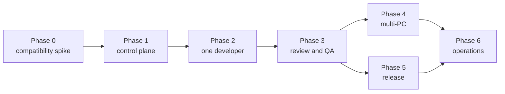

# 단계별 구현 계획

이 계획은 처음부터 모든 역할과 PC를 연결하지 않는다. 한 개의 test repository와 한
개의 developer agent로 전달 보장과 권한 경계를 검증한 뒤 역할과 substrate를 늘린다.

## 성공 기준

최종적으로 다음을 만족해야 한다.

1. Kaneo `Ready` task 하나가 정확히 하나의 active execution lease를 만든다.
2. worker 중단이나 webhook 재전송 후에도 중복 PR/배포가 생기지 않는다.
3. 서로 다른 PC의 agent instance와 모든 외부 side effect를 추적할 수 있다.
4. native mode의 developer App은 GitHub gate를 우회할 수 없고, Free-private mode의 LLM
   developer는 target repository write token 자체를 받지 않는다.
5. reviewer는 developer와 다른 identity로 현재 PR head를 검토해야 한다.
6. required CI가 성공하지 않으면 GitHub native gate 또는 merge broker가 merge를
   거부한다.
7. production release는 GitHub environment 또는 외부 approval ledger에서 allowlist된
   사람의 artifact-digest-bound 승인이 필요하다.
8. subscription profile별 agent 수, 실행 시간, 인증 generation과 provider limit 발생을
   추적할 수 있다. 초기에는 정확한 persona별 비용 산출을 성공 조건으로 두지 않는다.
9. host HOME, container socket, cluster-admin credential이 agent container에 보이지 않는다.
10. 운영자가 Buzz와 Kaneo에서 진행 상태와 근거 링크를 확인할 수 있다.

## Phase 0 — 호환성 및 위험 스파이크

목표: 문서에서 본 upstream 기능과 실제 클러스터/PC의 기능 차이를 제거한다.

### 작업

- [ ] `source ./source.sh` 후 실제 Buzz/Kaneo/Zot version과 image digest를 수집한다.
- [ ] Claude `setup-token` host single-writer/read-only sandbox 공유를 두 agent로 검증한다.
- [ ] Codex host `auth.json` read-only 공유의 장기 실행과 token refresh/write 동작을
  검증하고 실패 시 agent별 login fallback을 기록한다.
- [ ] OAuth credential generation 교체 중 drain/restart 및 secret 비노출을 검증한다.
- [ ] 대상 GitHub host가 GitHub.com, GHES 또는 둘 다인지 정하고 GHES exact
  version/patch/license를 기록한다.
- [ ] organization plan과 repository visibility를 기록하고 protected branch, ruleset,
  required check/review, CODEOWNERS, environment, hosted runner capability를 실제 API로
  probe한 뒤 operator가 snapshot을 확정한다.
- [ ] GitHub.com webhook public ingress 또는 GHES private webhook network path를
  검증한다. GHES App은 event 대상 organization마다 설치되는지 확인한다.
- [ ] Buzz 실제 owner pubkey/membership enforcement와 relay auth를 확인하고, 도구 권한을
  가진 agent 투입 전에 폐쇄 membership을 강제한다.
- [ ] Kaneo dummy `authSecret`/DB password의 실제 사용 여부를 확인하고 Secret 기반으로
  안전하게 회전한다.
- [ ] Buzz local chart `0.1.8-k8s-test.2`가 배포하는 binary에 `buzz-cli`, workflow,
  `buzz-acp`, persona, remote-agent 기능이 포함되는지 확인한다.
- [ ] 필요한 기능이 없다면 Buzz upgrade 전략을 별도 ADR로 작성하고 chart/image를
  digest에 고정한다.
- [ ] Kaneo install을 release tag 또는 commit에 고정하고 chart dependency까지
  재현 가능한지 `helm template`로 확인한다.
- [ ] Kaneo test project에서 API key scope, outgoing webhook HMAC, REST read/write,
  `/api/mcp`를 검증한다.
- [ ] test organization/repository에 `darimuri-agent-developer-a`,
  `darimuri-agent-reviewer-a` App을 만들고
  최소 permission/event manifest를 검증한다. `agent-control`은 Issues/Projects dispatch
  또는 중앙 reconciliation 구현 전까지 `darimuri-agent-control-a` manifest만 작성한다.
- [ ] Developer App으로 branch와 PR을 생성해 App bot이 author가 되고, 사람 owner가
  self-approval 제한 없이 최종 승인할 수 있는지 검증한다.
- [ ] 권한 없는 사용자의 `/agent run`과 권한 있는 사용자의 `agent:ready` label을 비교해
  GitHub Issue dispatch actor 검증을 시험한다.
- [ ] test repository에서 ruleset/branch protection의 required Check Run, required human
  approval, last-push approval, stale approval dismiss, bypass 금지를 검증한다.
- [ ] 별도 Free-private test repository에서 developer read-only, patch upload,
  publisher branch/PR, merge broker gate, direct-bypass 경보를 검증한다.
- [ ] GitHub.com은 hosted runner, GHES는 ephemeral/JIT 또는 ARC runner에서 untrusted
  test workflow를 실행해 격리와 log 보존을 검증한다.
- [ ] GHES라면 GitHub Connect 또는 `actions-sync` mirror, action SHA pin, offline tool
  cache 정책을 정한다.
- [ ] 각 후보 PC의 OS/arch, rootless Podman, cgroup, systemd user lingering, disk quota,
  outbound network를 조사한다.
- [ ] release 대상과 production 승인자를 확정한다.

### 산출물

- `adr/0003-version-baseline.md`
- `adr/0004-worker-runtime.md`
- `GITHUB-CAPABILITIES.md`
- 검증 명령과 실제 결과를 담은 `SPIKE-RESULTS.md`
- test repository와 폐기 가능한 test agent 계정

### 수락 조건

- 실제 version/digest와 기능 matrix가 문서화된다.
- Kaneo event 한 개를 받아 signature를 검증하고 task를 API로 다시 조회할 수 있다.
- Buzz mention 한 개를 test harness가 수신하고 응답할 수 있다.
- native mode에서는 developer App installation token이 지정 feature branch에는
  push하지만 default branch와 Checks API에서는 거부된다. merge API 호출은 미충족
  ruleset으로 거부된다.
- external mode에서는 LLM developer가 target repository에 push할 수 없고 검증된
  publisher만 feature branch/PR을 만든다.
- required GitHub Actions/agent-review check 실패 상태에서 native gate 또는 merge
  broker가 test PR merge를 실제로 거부한다.
- native/enterprise mode에서는 production environment가 self-review와 승인 전 secret
  접근을 막는다. external mode에서는 GitHub에 production secret가 없고 deploy broker가
  승인 없는 배포를 거부한다.
- rootless sandbox에서 host HOME, socket, kubeconfig 접근이 실패한다.

### 중단 조건

다음 중 하나면 Phase 1로 가지 않고 설계를 수정한다.

- Buzz/Kaneo 필수 기능 upgrade가 현재 data migration과 양립하지 않음
- Kaneo event actor를 승인 정책에 사용할 만큼 신뢰할 수 없거나 API 재조회 불가
- 대상 GitHub/GHES가 required check/review/environment gate를 실제로 강제하지 못하고
  publisher/merge/deploy broker fallback도 안전하게 구성할 수 없음
- worker sandbox에서 host credential 또는 container socket이 노출됨

## Phase 1 — Control plane skeleton

목표: LLM 없이 event ingest, queue, lease, 상태 reconciliation을 완성한다.

### 구현 범위

- [ ] Go module로 `orchestratord`와 `agent-workerd` protocol 정의
- [ ] 전용 PostgreSQL과 migration: `events`, `jobs`, `leases`, `effects`, `outbox`,
  `agent_instances`, `approvals`
- [ ] Kaneo webhook endpoint: raw body HMAC 검증, size limit, content type, dedupe
- [ ] GitHub App webhook endpoint: `X-Hub-Signature-256`, `X-GitHub-Delivery`, host별
  secret 검증
- [ ] GitHub host adapter: GitHub.com/GHES REST/GraphQL base URL과 capability profile
- [ ] `native-guarded`, `external-guarded`, `enterprise-guarded` mode 선택과 확정된
  capability snapshot 저장
- [ ] GitHub App credential broker: private key 보관, scoped installation token 발급/갱신
- [ ] GitHub Issue intake: actor permission 재조회, label/slash-command policy, Kaneo task
  단일 생성과 reciprocal link
- [ ] Free-private publisher: patch/base-SHA/path/high-risk file/effect-key 검증 후
  feature branch/PR 생성
- [ ] Free-private merge broker: current SHA의 CI/reviewer/human approval을 조회한 뒤 merge
- [ ] broker 밖의 default-branch push/merge 탐지와 Buzz/Kaneo 경보
- [ ] Buzz workflow webhook 또는 dispatcher adapter
- [ ] 정책 evaluator: task status/label/risk/repo/role와 actor allowlist
- [ ] worker register, capability advertise, long-poll claim, heartbeat, complete/fail API
- [ ] lease expiry reconciler와 dead-letter operator API/CLI
- [ ] Kaneo/GitHub/Buzz authoritative-state reconciliation sweep와 cursor/checkpoint
- [ ] outbox delivery로 Kaneo comment/status 및 Buzz summary 전송
- [ ] Prometheus metrics와 structured log

### 설계 규칙

- source payload를 받은 transaction에서 normalized event와 outbox/job을 함께 기록한다.
- HTTP 2xx는 durable 저장 후에만 반환한다.
- 외부 API 호출을 DB transaction 안에서 하지 않는다.
- Buzz/Kaneo/GHES 내부 DB에 직접 연결하지 않는다.
- API에는 job payload가 아닌 reference를 저장하고 secret는 저장하지 않는다.
- Kaneo built-in GitHub integration과 오케스트레이터 중 한쪽만 issue/task create writer가
  되도록 한다.

### 수락 조건

- 동일 webhook을 100회 재전송해도 job row는 하나다.
- 동일 `X-GitHub-Delivery`를 100회 재전송해도 event/effect는 하나다.
- 같은 GitHub Issue event와 Kaneo reconciliation을 반복해도 Kaneo task는 하나다.
- Free-private patch를 반복 제출해도 publisher가 branch/PR을 하나만 만든다.
- native gate가 없다는 사실이 `external-guarded`로 노출되고 보호 수준을 native와 같다고
  보고하지 않는다.
- 두 mock worker가 동시에 claim해도 active lease는 하나다.
- lease 직후 worker를 강제 종료하면 expiry 후 `reconciling`을 거쳐 안전하게 재queue된다.
- Kaneo/Buzz가 일시 중단돼도 outbox가 보존되고 복구 후 전달된다.
- Kaneo webhook을 의도적으로 버려도 polling sweep가 `Ready` task를 발견해 동일 job을
  하나만 생성한다.
- 모든 event/job/effect가 하나의 correlation ID로 조회된다.

## Phase 2 — 한 PC, 한 developer agent

목표: test task에서 branch와 PR까지 end-to-end 자동화한다.

### 구현 범위

- [ ] Linux PC 한 대에 rootless Podman과 worker Quadlet 설치
- [ ] worker/agent image를 Zot에 push하고 digest pin
- [ ] ephemeral workspace, resource limit, timeout, cleanup 구현
- [ ] developer persona와 허용 tool/MCP 목록 작성
- [ ] Buzz/Kaneo identity, host subscription credential profile과 mode별 GitHub App
  installation 설정
- [ ] Claude/Codex credential directory는 host만 write하고 sandbox에는 read-only mount
- [ ] persona별 runtime config/session/cache와 workspace volume 분리
- [ ] native mode는 job repository와 `contents/pull_requests` permission만 가진 1시간
  token을 developer에게 발급한다.
- [ ] external mode는 developer에게 `contents: read`만 주고 patch bundle을 publisher에
  제출한다. publisher/merge App private key는 worker에 전달하지 않는다.
- [ ] task snapshot과 base SHA를 agent input으로 전달
- [ ] branch naming: `agent/<task-number>-<slug>`
- [ ] PR 본문에 Kaneo task, job ID, base/head SHA, test evidence 링크 포함
- [ ] 실패/중단/clarification 결과를 Kaneo와 Buzz에 projection

### 수락 조건

- `Ready` task가 자동으로 `In Progress`가 되고 PR URL을 갖는다.
- native mode agent는 default branch push/Checks/미충족 merge가 거부된다.
- external mode agent는 모든 target repository push가 거부되고 publisher만 feature
  branch를 만든다.
- job 종료 후 workspace와 mounted secret가 사라진다.
- 같은 job을 강제로 재시도해도 새 PR이 중복 생성되지 않는다.
- host credential 교체 후 해당 profile의 agent가 drain/restart되고 fresh ACP session으로
  정상 복구된다.
- credential이 workspace, log, Buzz, Kaneo, Git에 노출되지 않는다.

## Phase 3 — 독립 Review와 QA gate

목표: author와 독립된 검토 및 재현 가능한 CI gate를 추가한다.

### 구현 범위

- [ ] reviewer/QA용 별도 Kaneo/Buzz identity, runtime state와 `agent-reviewer` GitHub App 생성
- [ ] GitHub ruleset/branch protection을 JSON/IaC로 선언하고 drift check
- [ ] developer App이 PR author/last pusher가 되며 bypass list에 없음을 검증
- [ ] required GitHub Actions workflow: lint/unit/integration/security/build 중 repo별
  가능한 항목
- [ ] Actions/check webhook을 revision-bound result로 저장
- [ ] required checks 성공 후에만 review job 생성
- [ ] reviewer가 현재 head SHA를 읽고 outdated review를 승인으로 계산하지 않도록 처리
- [ ] reviewer가 `agent-review/<policy-version>` Check Run을 현재 head SHA에 게시
- [ ] developer와 reviewer App/instance가 같으면 policy deny
- [ ] native mode는 required Check, external mode는 merge broker query로 같은 review
  결과를 강제
- [ ] QA failure는 PR block과 Kaneo 상태/comment에 반영

### 수락 조건

- developer App/token으로 Checks API가 권한 거부된다. native merge API는 GitHub gate,
  external merge 요청은 broker policy가 거부한다.
- 실패한 required check가 하나라도 있으면 merge할 수 없다.
- review 후 새 commit을 push하면 이전 SHA의 review Check Run이 gate를 충족하지 않는다.
- reviewer worker가 중단돼도 review comment가 중복되지 않는다.
- Kaneo task에 CI run, review, head SHA evidence가 연결된다.

## Phase 4 — 여러 PC와 여러 provider/account

목표: capability 기반 분산 실행과 장애 복구를 검증한다.

### 구현 범위

- [ ] 두 번째/세 번째 worker PC 등록, 각 instance identity 분리
- [ ] capability selector: OS/arch/toolchain/trust-tier/GPU/provider/account class
- [ ] worker drain, maintenance, unhealthy quarantine
- [ ] 동일 persona의 여러 instance에 공정 배정하되 job당 단일 lease 유지
- [ ] subscription profile별 동시성/WIP limit과 provider usage-limit 대응 정책
- [ ] credential reference와 rotation/revoke runbook
- [ ] host credential generation 변경 감지와 관련 agent 일괄 drain/restart
- [ ] worker와 control plane 사이 mTLS 또는 private overlay network
- [ ] GitHub.com/GHES host별 rate limit, API version, App installation/token refresh 처리
- [ ] chaos 시나리오: network partition, reboot, disk full, LLM 429, GitHub timeout/token
  expiry

### 수락 조건

- 두 PC가 동시에 대기해도 task 하나는 한 PC만 실행한다.
- 실행 중 PC 전원을 끄고 복구했을 때 중복 side effect 없이 완료 또는 dead-letter된다.
- 한 provider/account의 budget 소진이 다른 account job을 오염시키지 않는다.
- worker drain 중에는 새 lease를 받지 않고 기존 job만 정리한다.
- instance별 audit와 비용 귀속이 유지된다.

## Phase 5 — Release candidate와 사람 승인 배포

목표: immutable artifact를 사람 승인 후 제한된 deployer가 배포한다.

### 구현 범위

- [ ] release candidate agent: changelog, version PR, candidate tag/digest
- [ ] GHCR/GHES Packages 또는 Zot의 image signature/SBOM/provenance와 vulnerability check
- [ ] `approvals` record에 approver, artifact digest, environment, expiry, source event 저장
- [ ] allowlist human + author separation + current digest 정책
- [ ] native/enterprise mode의 GitHub Actions `production` environment: required reviewers,
  prevent self-review, protected branch/tag, bypass 금지
- [ ] external mode의 digest-bound external approval ledger와 GitHub 외부 secret store
- [ ] production credential을 가진 별도 ephemeral Actions runner 또는 외부 deploy broker
  pool
- [ ] canary/health check/rollback workflow
- [ ] Buzz와 Kaneo에 승인 요청, 결과, deployment evidence projection
- [ ] break-glass 절차와 모든 bypass audit

### 수락 조건

- agent/Buzz bot/Kaneo bot이 만든 승인은 production에 사용할 수 없다.
- native/enterprise mode에서는 GitHub Actions environment 승인 전 production secret이
  runner에 전달되지 않는다. external mode에서는 승인 전 deploy broker가 credential을
  발급하지 않는다.
- 승인 후 artifact digest가 바뀌면 배포가 거부된다.
- developer/reviewer/release-candidate container에서 production secret를 찾을 수 없다.
- deploy 실패 시 이전 digest로 자동 또는 승인된 rollback이 가능하다.
- 배포 전후의 task, PR, checks, approval, digest, environment가 하나의 audit chain으로
  조회된다.

## Phase 6 — 운영 안정화

목표: 장기 상시 운영에 필요한 SLO, backup, upgrade, 보안 운영을 완성한다.

### 구현 범위

- [ ] SLO: dispatch latency, queue age, completion rate, reconciliation time
- [ ] VictoriaMetrics dashboard/alert: dead-letter, lease expiry spike, auth/signature failure,
  budget exhaustion
- [ ] PostgreSQL backup/restore drill과 RPO/RTO 기록
- [ ] Buzz/Kaneo/orchestrator와 GHES 운영 시 GHES data의 서로 다른 backup 책임 정의
- [ ] image/chart/dependency update cadence와 staging smoke test
- [ ] credential rotation과 compromised agent revoke drill
- [ ] prompt injection/red-team test corpus
- [ ] concurrency/load test와 per-role WIP limit

### 수락 조건

- 빈 database/새 worker에 restore한 뒤 미완료 job을 reconcile할 수 있다.
- agent instance 하나의 모든 key를 revoke하고 다른 instance는 계속 동작한다.
- alert에서 Kaneo task와 job/run log까지 추적할 수 있다.
- upgrade 실패 시 이전 digest/chart로 rollback할 수 있다.

## 구현 순서와 의존성



Phase 4와 Phase 5는 Phase 3 이후 일부 병렬 진행할 수 있지만, production release는
multi-PC보다 권한 분리와 rollback 검증을 우선한다.

## 초기 Kaneo workflow 제안

```text
Inbox
  -> Needs clarification
  -> Ready
  -> In progress
  -> CI
  -> Review
  -> Human approval       # 고위험 작업에만
  -> Done

예외 상태: Blocked, Reconcile, Dead letter, Cancelled
```

필수 task metadata:

- target repository
- acceptance criteria
- risk: low/medium/high/production
- requested role 또는 자동 선택 label
- dependency/blocker
- 자동화 허용 여부
- 관련 Buzz channel/thread

## 초기 persona set

처음부터 모든 역할을 만들지 않는다.

1. `dispatcher`: Buzz 요청을 Kaneo task로 정규화, shell/Git write 없음
2. `developer`: 한 test repo의 feature branch만 push
3. `reviewer`: repo/CI read와 review comment만 허용
4. `qa`: Phase 3에서 추가
5. `release-candidate`, `deployer`: Phase 5에서 마지막으로 추가

persona pack에는 prompt와 tool 선언만 둔다. 실제 secret, lease, sandbox, cleanup은 worker
설정이 소유한다.

## 예상 운영 비용과 복잡도

초기 추가 인프라는 orchestrator Deployment, 전용 PostgreSQL, 각 PC의 작은 worker
daemon이다. 별도 message broker나 Temporal cluster는 도입하지 않는다. 주요 변동 비용은
초기에는 Claude/Codex subscription 비용이며 정확한 persona별 token cost는 제공되지 않을
수 있다. subscription usage limit과 내부 job 실행량을 함께 관측한다. API 종량 과금,
중앙 budget 또는 provider fallback이 필요할 때 LiteLLM을 후속 도입한다. 운영 복잡도가
다음 수준을 넘을 때만 Temporal/NATS 같은 별도 시스템을 재평가한다.

- 수백 개의 동시 장기 workflow
- 수일~수주짜리 human wait가 대량 발생
- 여러 cluster/region을 걸친 queue federation
- PostgreSQL queue가 측정된 병목이 됨
- replay/backfill을 위한 event streaming 요구가 명확해짐

## 다음 작업

승인 후 바로 구현하기보다 Phase 0만 먼저 수행하는 것이 적절하다. 첫 변경 범위는
다음으로 제한한다.

1. 실제 설치 버전/digest 조사
2. Buzz mention, Kaneo signed webhook, GitHub App webhook과 native/external merge gate의
   smoke test
3. 한 Linux PC에서 rootless sandbox escape boundary 확인
4. Claude/Codex subscription OAuth read-only 공유와 rotation smoke test
5. 결과를 바탕으로 version pin과 worker runtime ADR 확정
